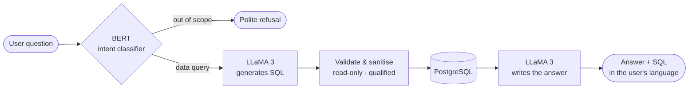

<div align="center">

# 🤖 AI Assistant for Data Querying

**Ask your business data a question in plain language and get the answer.**

Natural-language → SQL assistant built into the StoresAce retail & restaurant management platform.


**English** · [Português](README.pt.md)


<sub>Live demo on the StoresAce platform: every answer shows the SQL query that produced it.</sub>

</div>

---

## 📌 About

Final project for the **BSc in Computer Engineering** at ESTG – Polytechnic of Porto, developed during my internship at **StoresAce** (March–July 2025), a cloud SaaS platform used by retail and restaurant chains.

**The problem:** the platform holds sales, stock, price, purchasing and HR data, but finding one specific number meant knowing where it lived, clicking through reports, or contacting support.

**The solution:** a chat assistant inside the platform. The user types *"How many stores do we have?"* or *"Which item with the highest markup was sold in each store in January?"* and gets a short answer in their own language, together with the SQL used to get it.

## ✨ Highlights

| | |
|---|---|
| 🧠 **Intent classification** | Fine-tuned BERT decides whether a question is a data query or out of scope |
| 🛢️ **Text-to-SQL** | LLaMA 3 on Amazon Bedrock writes PostgreSQL from the question, the schema and the context |
| 🔒 **Safe by design** | Read-only queries, destructive commands blocked, schema-qualified names, whitelisted tables |
| 🌍 **8 languages** | Always answers in the language selected in the UI, whatever language the question is in |
| 🗂️ **Conversation memory** | The last 3 exchanges are kept as context, so follow-up questions work |
| 🔍 **Transparent answers** | Each answer shows the generated SQL, so it can be checked |
| 👍👎 **Feedback loop** | Like/dislike per answer; critical dislikes email the team with the question, answer and SQL |

## ⚙️ How it works



1. **Classify.** BERT predicts the intent. Below 0.75 confidence the question is treated as out of scope.
2. **Generate.** LLaMA 3 receives a prompt with the question, the database schema, the recent conversation and the company's existing reports, and returns a PostgreSQL query.
3. **Validate.** The SQL is cleaned: only read commands are allowed, and table and column names are qualified against a schema generated from the Django ORM.
4. **Execute.** The query runs on a whitelisted set of tables: sales, stock, items, stores, prices, budgets and forecasts.
5. **Answer.** LLaMA 3 turns the rows into a short, human answer in the selected language.

## 🔬 Under the hood

### BERT: the classifier
A pre-trained BERT model, fine-tuned on a dataset of example questions I wrote for the StoresAce domain. Its only job is to decide *is this a data question?*, so it is fast, cheap and predictable. It is loaded into memory once as a singleton, and new intents are detected by hashing so they can feed future retraining.

### LLaMA 3: SQL and answers
I chose LLaMA 3 after testing the models available on Amazon Bedrock (Titan, Mistral and LLaMA). It gave the best results and has the best documentation. Its behaviour comes from **prompt engineering**:

- **Variables**: question, schema, conversation context, `reports_SA`
- **Guidelines**: rules for what the model may and may not generate
- **Support files**: curated question → SQL examples

`reports_SA` made the biggest difference. StoresAce already had many reports, each with a description and a tested SQL query. With those in the prompt, the model can find a similar report and reuse its query instead of writing complex joins from scratch.

<details>
<summary><b>Example of generated SQL</b></summary>

*"Which item with the highest sale markup was sold in January?"*

```sql
WITH ranked_items AS (
    SELECT i.id AS item_id,
           i.description AS item_name,
           SUM(ds.total_quantity) AS total_sold,
           i.sale_markup,
           ROW_NUMBER() OVER (ORDER BY i.sale_markup DESC) AS rn
    FROM demo_uk.da_items_stores_date ds
    JOIN demo_uk.items i ON ds.item_id = i.id
    WHERE ds.date >= DATE('2025-01-01')
      AND ds.date <= DATE('2025-01-31')
      AND ds.total_quantity > 0
    GROUP BY i.id, i.description, i.sale_markup
)
SELECT item_name FROM ranked_items WHERE rn = 1;
```
</details>

## 🧭 From brief to delivery

The internship started from a short brief: an AI assistant that answers questions about business data, with GPT or LLaMA turning questions into SQL. I spent the first weeks studying the suggested technologies and prototyping, then made these design decisions:

| The brief suggested | What I built | Why |
|---|---|---|
| OpenAI GPT | **LLaMA 3 on Amazon Bedrock** | StoresAce already ran on AWS; after testing Titan, Mistral and LLaMA, LLaMA gave the best results |
| Sending every question straight to the LLM | **BERT intent classifier first** | Out-of-scope questions are filtered out before any LLM call, so cost is lower and answers are more predictable |
| Running the generated SQL as returned | **Validation layer**: read-only, whitelisted tables, qualified names | LLM output can't be trusted blindly in a production database |
| Embeddings + RAG as a future improvement | **`reports_SA`**: existing tested report queries in the prompt | Same goal (reuse validated SQL), with less infrastructure |
| Answering data questions | **Plus** 8 languages, conversation memory, like/dislike feedback | Needed to make it usable for real StoresAce customers |

Business *recommendations* (e.g. pricing suggestions) were also part of the original idea and remain future work.

## 🏗️ Architecture

<table>
<tr>
<td width="42%"></td>
<td>

| Layer | Technologies |
|---|---|
| **Frontend** | Vue.js, Vuetify, AJAX |
| **Backend** | Python, Django |
| **AI / NLP** | BERT (Hugging Face), LLaMA 3 (Amazon Bedrock), MiniLM |
| **Data** | PostgreSQL, Pandas |
| **Process** | Scrum: weekly sprint reviews, daily check-ins |

</td>
</tr>
</table>

### API

| Method | Endpoint | Parameters | Description |
|---|---|---|---|
| `GET` | `/chatbot/` | — | Assistant page (authenticated users) |
| `POST` | `/chatbot/message/` | `question`, `session_id` (optional) | Returns the answer, the intent and the generated SQL |
| `POST` | `/chatbot/report-dislike/` | `question`, `answer`, `sql` (optional) | Negative feedback; emails the team when critical |

## 📸 Screenshots

| Asked in Portuguese, answered in the selected language (Spanish) | Out-of-scope detection |
|---|---|
|  |  |


## 📂 What's in this repository

> The source code belongs to StoresAce and is not published. This repository documents the project.

| | Files |
|---|---|
| 🎬 **Demo video** (1 min) | [`MP4`](Video/PF_ER_Video_8220307.mp4) |
| 📊 **Jury presentation** | [`PDF`](Apresentacao/PF_ER_Apresentacao_8220307.pdf) · [`PowerPoint`](Apresentacao/PF_ER_Apresentacao_8220307.pptx) |
| 📄 **Internship report** (Portuguese) | [`PDF`](PF_ER_Relatorio_8220307.pdf) · [`Word`](PF_ER_Relatorio_8220307.docx) |

## 🚀 Results & future work

**Delivered:** a working assistant integrated into the StoresAce platform. It answers from real data in 8 languages and reduces the need to contact support for simple data lookups.

**Next steps:**
- Cover the remaining database tables and handle more complex questions
- Add business recommendations, such as pricing and profitability suggestions
- Grow into an AI help center that suggests answers to the support team from a knowledge base
- Move the intent model from a local file to a cloud bucket for a scalable, cloud-native setup

## 👤 Author

**Pedro Pinho** · [GitHub](https://github.com/PedroPinho17) · [LinkedIn](https://www.linkedin.com/in/pedropinho19/)

Supervisors: Prof. Marco Gomes (ESTG/P.Porto) · Eng. Ivo Marinho (StoresAce)
