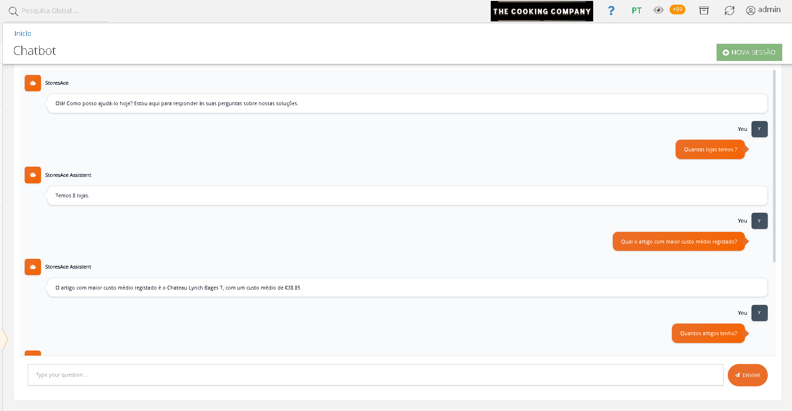
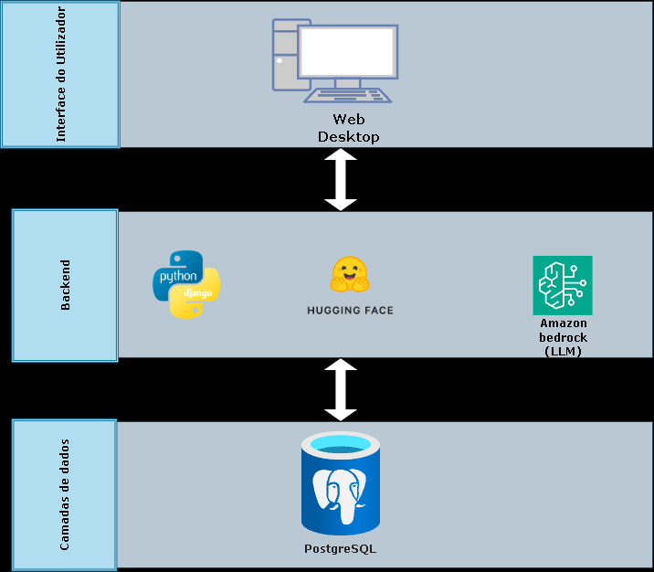
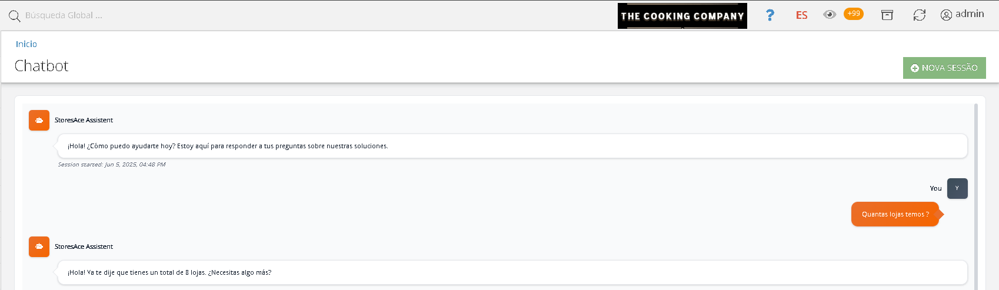
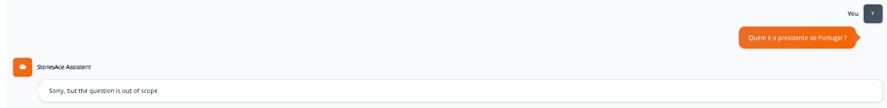

# AI Assistant for Data Querying

**English** · [Português](README.pt.md)

Final project (internship) for the **BSc in Computer Engineering** at ESTG – Polytechnic of Porto, developed at **StoresAce** (March–July 2025).

An intelligent assistant integrated into the StoresAce retail & restaurant management platform. Users ask questions about their business data in natural language ("How many stores do we have?", "Which item had the highest average cost?") and get a clear answer, without needing to know where the data lives or how to write SQL.



## How it works

```
Question ─▶ BERT intent classifier ─┬─▶ Out-of-scope ─▶ polite refusal
                                    │
                                    └─▶ SQL / Data Query
                                          │
                                          ▼
                              LLaMA (Amazon Bedrock) generates SQL
                                          │
                                          ▼
                       Validation & sanitisation (read-only, schema-qualified)
                                          │
                                          ▼
                                 Executed on PostgreSQL
                                          │
                                          ▼
                LLaMA turns the result into a natural-language answer
```

1. **Intent classification** – a fine-tuned BERT model (Hugging Face) decides whether the question is a data query or out of scope. Predictions below 0.75 confidence are treated as out of scope.
2. **SQL generation** – LLaMA, served through Amazon Bedrock, writes a PostgreSQL query from the question, the database schema and the conversation context.
3. **Validation** – the generated SQL is sanitised: only read commands are allowed, destructive statements are blocked, and table/column names are qualified against the dynamic schema (generated via the Django ORM) to prevent SQL injection.
4. **Execution** – the query runs against a whitelisted set of tables (sales, stock, items, stores, prices, budgets, forecasts…).
5. **Natural response** – the rows are turned into a short human answer in the user's selected language.

## Architecture

<p align="center"></p>

| Layer | Technologies |
|---|---|
| Frontend | Vue.js, Vuetify, AJAX |
| Backend | Python, Django |
| AI / NLP | BERT (Hugging Face), LLaMA via Amazon Bedrock |
| Data | PostgreSQL, Pandas |
| Process | Scrum (weekly sprint reviews, daily check-ins), Git/GitHub |

## Features

- 💬 Chat interface for natural-language questions
- 🧠 Intent classification with BERT, with automatic out-of-scope detection
- 🛢️ Text-to-SQL with LLaMA on Amazon Bedrock
- 🔒 SQL validation: read-only, blocks destructive commands, prevents injection
- 🌍 **8 languages**: the assistant always replies in the language selected in the UI, even when asked in another one
- 🗂️ Short-term memory: the last 3 exchanges of the session are kept as context
- 👍👎 Like/dislike feedback; critical dislikes notify the team by email
- 📋 Session management with history and dates
- ⚡ BERT model loaded once in memory (singleton)

| Multilingual answers | Out-of-scope detection |
|---|---|
|  |  |

## API endpoints

| Method | Endpoint | Parameters | Description |
|---|---|---|---|
| `GET` | `/chatbot/` | — | Assistant page (authenticated users) |
| `POST` | `/chatbot/message/` | `question`, `session_id` (optional) | Sends a question and returns the answer, intent and generated SQL |
| `POST` | `/chatbot/report-dislike/` | `question`, `answer`, `sql` (optional) | Negative feedback; emails the team when critical |

## Repository contents

| File | Description |
|---|---|
| [`PF_ER_Relatorio_8220307.pdf`](PF_ER_Relatorio_8220307.pdf) | Full internship report (Portuguese) |
| [`PF_ER_Relatorio_8220307.docx`](PF_ER_Relatorio_8220307.docx) | Report source document |
| [`Video/PF_ER_Video_8220307.mp4`](Video/PF_ER_Video_8220307.mp4) | Project demo video |

> The source code belongs to StoresAce and is not included. This repository documents the work through the report, the diagrams and the demo.

## Future work

- Use the assistant to help the support team, suggesting answers from a StoresAce knowledge base
- Store the intent model in a bucket (or the database) instead of a local file, for a more scalable, cloud-native setup

## Author

**Pedro Pinho** – [GitHub](https://github.com/PedroPinho17) · [LinkedIn](https://www.linkedin.com/in/pedropinho19/)

Supervisors: Prof. Marco Gomes (ESTG/P.Porto) · Eng. Ivo Marinho (StoresAce)
