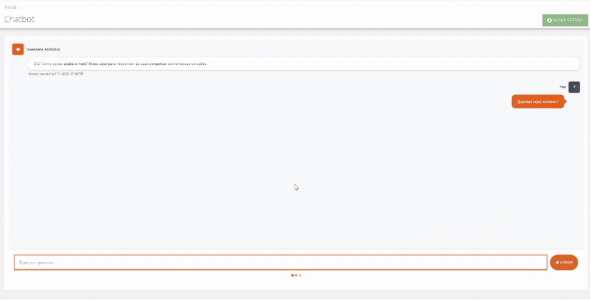
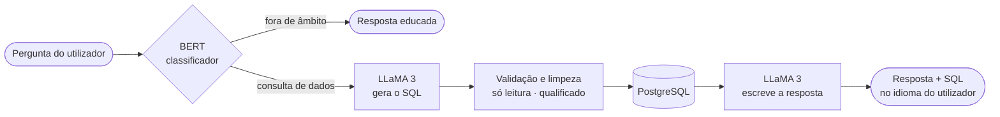
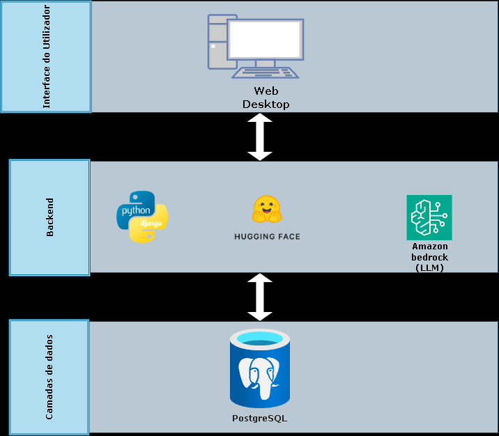
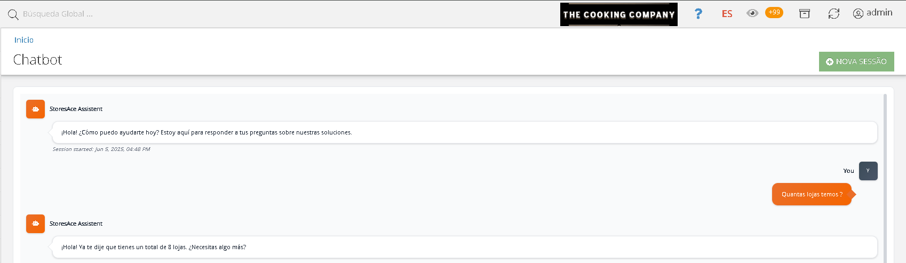
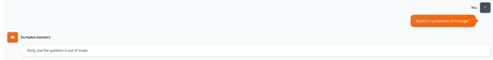
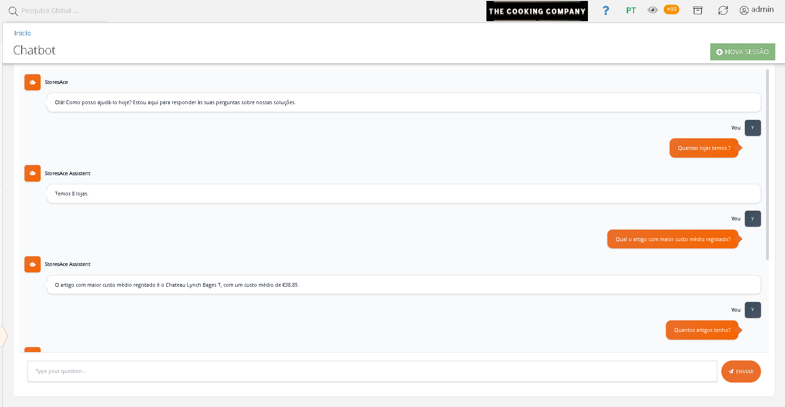

<div align="center">

# 🤖 Assistente de IA para Consulta de Dados

**Faz uma pergunta aos dados do teu negócio em linguagem natural e recebe a resposta.**

Assistente de linguagem natural → SQL integrado na plataforma de gestão de retalho e restauração da StoresAce.


[English](README.md) · **Português**



<sub>Demonstração ao vivo na plataforma StoresAce: cada resposta mostra a query SQL que a originou.</sub>

</div>

---

## 📌 Sobre

Projeto Final da **Licenciatura em Engenharia Informática** da ESTG – Politécnico do Porto, desenvolvido durante o meu estágio na **StoresAce** (março–julho 2025), uma plataforma SaaS na cloud usada por cadeias de retalho e restauração.

**O problema:** a plataforma guarda dados de vendas, stocks, preços, compras e RH, mas encontrar um número específico obrigava a saber onde ele estava, a navegar por vários relatórios ou a contactar o suporte.

**A solução:** um assistente de chat dentro da plataforma. O utilizador escreve *"Quantas lojas temos?"* ou *"Qual o artigo com maior markup vendido em cada loja em janeiro?"* e recebe uma resposta curta, no seu idioma, junto com o SQL usado para a obter.

## ✨ Destaques

| | |
|---|---|
| 🧠 **Classificação de intenções** | BERT afinado decide se a pergunta é uma consulta de dados ou está fora de âmbito |
| 🛢️ **Text-to-SQL** | LLaMA 3 no Amazon Bedrock escreve PostgreSQL a partir da pergunta, do schema e do contexto |
| 🔒 **Seguro por desenho** | Só leitura, comandos destrutivos bloqueados, nomes qualificados, tabelas autorizadas |
| 🌍 **8 idiomas** | Responde sempre no idioma escolhido na interface, seja qual for a língua da pergunta |
| 🗂️ **Memória da conversa** | As últimas 3 interações ficam como contexto, por isso as perguntas de seguimento funcionam |
| 🔍 **Respostas transparentes** | Cada resposta mostra o SQL gerado, para poder ser verificado |
| 👍👎 **Feedback** | Gostei/Não gostei em cada resposta; os "não gostei" críticos enviam e-mail à equipa com a pergunta, a resposta e o SQL |

## ⚙️ Como funciona



1. **Classificar.** O BERT prevê a intenção. Abaixo de 0,75 de confiança, a pergunta é tratada como fora de âmbito.
2. **Gerar.** O LLaMA 3 recebe um prompt com a pergunta, o schema da base de dados, a conversa recente e os reportes que a empresa já tinha, e devolve uma query PostgreSQL.
3. **Validar.** O SQL é limpo: só são permitidos comandos de leitura, e os nomes de tabelas e colunas são qualificados com um schema gerado a partir do Django ORM.
4. **Executar.** A query corre sobre um conjunto restrito de tabelas: vendas, stocks, artigos, lojas, preços, orçamentos e previsões.
5. **Responder.** O LLaMA 3 transforma o resultado numa resposta curta e natural, no idioma escolhido.

## 🔬 Por dentro

### BERT: o classificador
Um modelo BERT pré-treinado, afinado (fine-tuning) com um conjunto de perguntas de exemplo que criei para o domínio da StoresAce. A única tarefa dele é decidir *isto é uma pergunta sobre dados?*, por isso é rápido, barato e previsível. É carregado em memória uma única vez (singleton), e as novas intenções são detetadas por hashing para alimentar treinos futuros.

### LLaMA 3: SQL e respostas
Escolhi o LLaMA 3 depois de testar os modelos disponíveis no Amazon Bedrock (Titan, Mistral e LLaMA). Foi o que deu melhores resultados e o que tem mais documentação. O comportamento dele vem do **prompt engineering**:

- **Variáveis**: pergunta, schema, contexto da conversa, `reports_SA`
- **Regras (guidelines)**: o que o modelo pode e não pode gerar
- **Ficheiros de apoio**: exemplos de pergunta → SQL

Os `reports_SA` foram o que fez mais diferença. A StoresAce já tinha muitos reportes, cada um com uma descrição e uma query SQL testada. Com eles no prompt, o modelo consegue encontrar um reporte parecido e reaproveitar a query, em vez de escrever joins complexos do zero.

<details>
<summary><b>Exemplo de SQL gerado</b></summary>

*"Qual o artigo com o maior sale_markup que foi vendido em janeiro?"*

```sql
WITH ranked_items AS (
    SELECT i.id AS item_id,
           i.description AS item_name,
           SUM(ds.total_quantity) AS total_sold,
           i.sale_markup,
           ROW_NUMBER() OVER (ORDER BY i.sale_markup DESC) AS rn
    FROM demo_uk.da_items_stores_date ds
    JOIN demo_uk.items i ON ds.item_id = i.id
    WHERE ds.date >= DATE('2025-01-01')
      AND ds.date <= DATE('2025-01-31')
      AND ds.total_quantity > 0
    GROUP BY i.id, i.description, i.sale_markup
)
SELECT item_name FROM ranked_items WHERE rn = 1;
```
</details>

## 🏗️ Arquitetura

<table>
<tr>
<td width="42%"></td>
<td>

| Camada | Tecnologias |
|---|---|
| **Frontend** | Vue.js, Vuetify, AJAX |
| **Backend** | Python, Django |
| **IA / NLP** | BERT (Hugging Face), LLaMA 3 (Amazon Bedrock), MiniLM |
| **Dados** | PostgreSQL, Pandas |
| **Processo** | Scrum: sprint reviews semanais, PSI diário |

</td>
</tr>
</table>

### API

| Método | Endpoint | Parâmetros | Descrição |
|---|---|---|---|
| `GET` | `/chatbot/` | — | Página do assistente (utilizadores autenticados) |
| `POST` | `/chatbot/message/` | `question`, `session_id` (opcional) | Devolve a resposta, a intenção e o SQL gerado |
| `POST` | `/chatbot/report-dislike/` | `question`, `answer`, `sql` (opcional) | Feedback negativo; envia e-mail à equipa se for crítico |

## 📸 Capturas de ecrã

| Pergunta em português, resposta no idioma escolhido (espanhol) | Deteção de fora de âmbito |
|---|---|
|  |  |



## 📂 O que está neste repositório

> O código-fonte pertence à StoresAce e não está publicado. Este repositório documenta o projeto.

| | Ficheiros |
|---|---|
| 🎬 **Vídeo de demonstração** (1 min) | [`MP4`](Video/PF_ER_Video_8220307.mp4) |
| 📊 **Apresentação ao júri** | [`PDF`](Apresentacao/PF_ER_Apresentacao_8220307.pdf) · [`PowerPoint`](Apresentacao/PF_ER_Apresentacao_8220307.pptx) |
| 📄 **Relatório de estágio** | [`PDF`](PF_ER_Relatorio_8220307.pdf) · [`Word`](PF_ER_Relatorio_8220307.docx) |

## 🚀 Resultados e trabalho futuro

**Entregue:** um assistente funcional integrado na plataforma StoresAce. Responde com dados reais em 8 idiomas e reduz a necessidade de contactar o suporte para consultas simples.

**Próximos passos:**
- Cobrir as restantes tabelas da base de dados e responder a perguntas mais complexas
- Evoluir para um help center com IA, que sugere respostas à equipa de suporte a partir de uma base de conhecimento
- Passar o modelo de intenções de um ficheiro local para um bucket na cloud, numa solução escalável e cloud-native

## 👤 Autor

**Pedro Pinho** · [GitHub](https://github.com/PedroPinho17) · [LinkedIn](https://www.linkedin.com/in/pedropinho19/)

Orientadores: Prof. Doutor Marco Gomes (ESTG/P.Porto) · Eng. Ivo Marinho (StoresAce)
